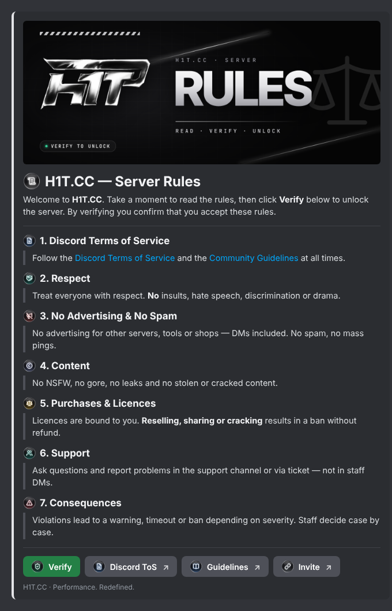

# H1T.CC Rules & Verify Bot

Ein kleiner Discord-Bot, der den Regel-Post im H1T-Stil schickt: Banner, Regeln mit eigenen Emojis, unten ein
**Verify**-Button (vergibt die Rolle) und Link-Buttons mit eigenen Emojis. Alles, was auf Discord erscheint, ist
**Englisch** (Post, Buttons, Bot-Antworten, Befehle). Texte, Links und Farbe stehen in `config.json`, die Emojis in
`design/emojis.json`.



## Einrichten (einmalig, ca. 10 Minuten)

1. **Bot anlegen:** <https://discord.com/developers/applications> → *New Application* → Name z. B. `H1T.CC`.
   Unter *Bot* → *Reset Token* → Token kopieren (geheim halten!). Unter *General Information* Avatar und Beschreibung setzen.
2. **Bot einladen:** *OAuth2* → *URL Generator* → Scopes `bot` und `applications.commands`, Rechte
   *Manage Roles*, *Send Messages*, *Attach Files*, *Embed Links*, *View Channels* → Link öffnen → Server wählen.
3. **Rollen:** Rolle `Verified` anlegen. Unter *Servereinstellungen → Rollen* die Bot-Rolle **über** `Verified` ziehen
   (sonst darf der Bot sie nicht vergeben).
4. **Kanäle:** `@everyone` sieht nur den Rules-Kanal (dort *Nachrichten senden* aus), `Verified` sieht den Rest.
5. **IDs kopieren:** Discord *Einstellungen → Erweitert → Entwicklermodus* an. Rechtsklick auf den Server →
   *Server-ID kopieren*, Rechtsklick auf die Rolle → *Rollen-ID kopieren*.
6. **Starten** (Node.js 20.12 oder neuer, <https://nodejs.org>): `.env.example` nach `.env` kopieren, Token,
   Server-ID und Rollen-ID eintragen, dann im Ordner `discord-bot`:

```bash
npm install
```

```bash
npm start
```

Beim ersten Start lädt der Bot die Emojis aus `assets/emojis` als App-Emojis hoch (sie belegen keinen Emoji-Platz auf
deinem Server) und registriert die Befehle.

7. Im Rules-Kanal **`/post-rules`** eingeben. Fertig.

Der Bot muss laufen, damit der Verify-Button funktioniert (eigener PC, VPS oder Bot-Hoster).

## Befehle (nur Admins)

| Befehl | Was er macht |
| --- | --- |
| `/post-rules` | Schickt den Post in diesen Kanal (oder `channel:`). Mit `message:` + ID eines alten Posts wird **dieser aktualisiert**: niemand muss sich neu verifizieren. |
| `/sync-emojis` | Lädt neue Emojis hoch. `replace:True` ersetzt geänderte Emojis mit gleichem Namen. |

## Anpassen

- **Texte, Regeln, Buttons:** `config.json` (auf Englisch). Neuer Link-Button:
  `{ "label": "Shop", "emoji": "h1t_link", "url": "https://…" }` in `links` (je 5 Buttons pro Reihe).
  Danach `npm run check`, Bot neu starten, `/post-rules message:<ID>`.
- **Eigene Emojis:**
  - *Fertiges Bild:* PNG/GIF (128×128, unter 256 KB) mit dem gewünschten Namen in `assets/emojis/` legen, z. B.
    `h1t_shop.png`, dann `/sync-emojis` und in `config.json` als `"emoji": "h1t_shop"` verwenden.
  - *Im H1T-Stil generieren:* Icon-SVG von <https://lucide.dev> in `design/icons/` legen, in `design/emojis.json`
    eintragen (Name, Icon, Leuchtfarbe) und `npm run design` ausführen (braucht Playwright mit Chromium).
    Das rendert auch Banner und Vorschau neu.
- **Banner:** `assets/banner.png` (1500×600) ersetzen oder in `design/render.cjs` (`bannerHtml`) ändern.
- **Rolle beim Verifizieren entfernen:** `UNVERIFIED_ROLE_ID` in `.env` (z. B. eine Rolle `Unverified`).

## Dateien

| Datei | Inhalt |
| --- | --- |
| `config.json` | Alle Texte, Regeln, Buttons, Farbe, Banner |
| `src/index.js` | Bot: Befehle, Verify-Button (Rolle + private Antwort) |
| `src/message.js` | Baut den Post (Components V2: Container, Banner, Text, Trenner, Buttons) |
| `src/emojis.js` | Lädt die Emojis als App-Emojis hoch |
| `scripts/check.js` | Prüft den Post offline gegen Discords Limits (`npm run check`) |
| `design/` | Emoji-Liste, Icons, Schriften, Logo und `render.cjs` für Emojis, Banner, Vorschau |

## Lizenzen

Icons: [Lucide](https://lucide.dev) (ISC, `design/icons/LICENSE-lucide.txt`). Schriften: Inter Tight und JetBrains Mono
(SIL OFL, `design/LICENSE-*.txt`). Logo: H1T.CC.
